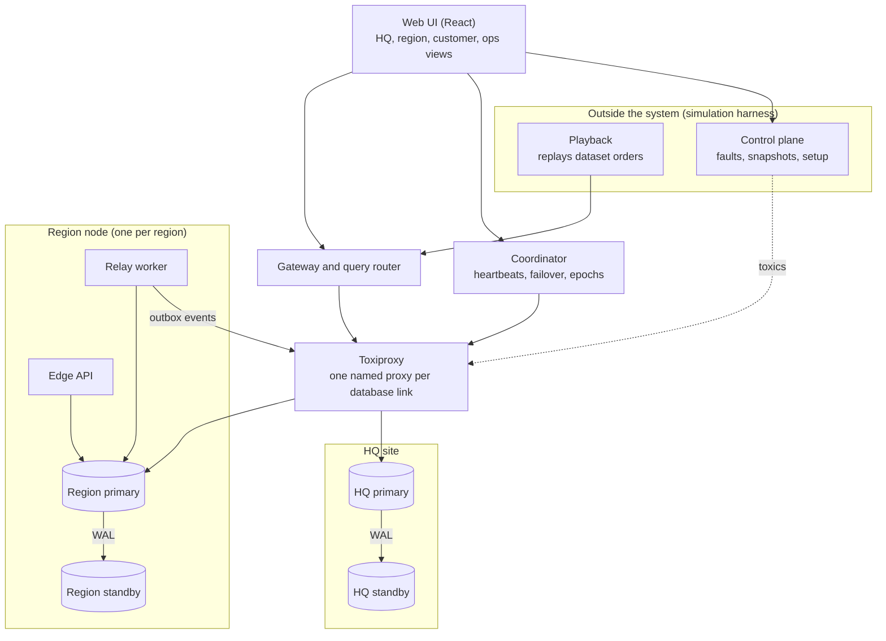
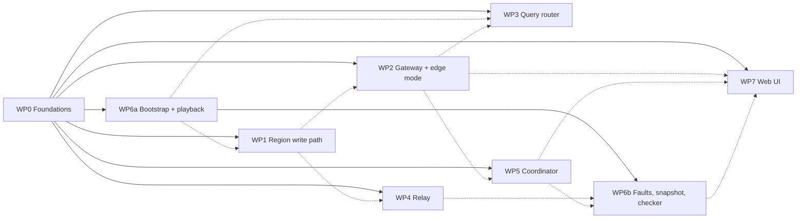

# RestaurantOS architecture and contracts

Status: **draft for team review, 2026-11-11.** This turns the Phase 2 design into a repository layout and a set of contracts (what goes in, what comes out) so four people can build in parallel. Items marked **OPEN (Dn)** are decisions the team still has to make; they are collected in Section 11.

The Phase 2 document stays the source of truth for *why*. This file is the source of truth for *where code lives and how parts talk*.

## 1. The big picture



Two kinds of components:

- **Inside** (would exist in a real deployment): the PostgreSQL nodes, gateway and query router, coordinator, relay workers, edge API, web UI.
- **Outside** (exists only because this is a simulation): bootstrap, playback, fault injection, snapshot and restore, invariant checker, and the control-plane API that lets the UI drive them.

### How the parts communicate

Toxiproxy is a TCP proxy, so it does not care what protocol runs through it. In our design the links it sits on are **database connections**, not HTTP calls. That gives three kinds of link:

| Link | Protocol | Through Toxiproxy |
| --- | --- | --- |
| UI or playback to gateway, coordinator, control plane | HTTP + JSON (REST) | no |
| Any service to any PostgreSQL node | PostgreSQL wire protocol (psycopg 3) | **yes, always** |
| Primary to standby | PostgreSQL streaming replication | yes |

So "REST or WebSocket" only matters for the browser. How the UI stays live (polling on an interval, or a subscription such as server-sent events) is deferred to the UI owner. The backend keeps both possible: every read route is a cheap idempotent `GET`, list routes take `since=`, and responses carry `data_as_of`.

There is no service-to-service HTTP on the core paths. The gateway, relay and coordinator are stateless Python processes that open SQL connections to the nodes. A "node" is a PostgreSQL primary plus its standby.

## 2. Repository layout

### Options considered

| # | Layout | Typical user | Trade-off for us |
| --- | --- | --- | --- |
| 1 | **Split by language**: `backend/`, `frontend/`, `infra/` | small full-stack teams | simple, but all Python ends up one level deeper for no gain |
| 2 | **`apps/` + `packages/`** (Turborepo, Nx, pnpm workspaces) | JavaScript-first monorepos | built for many JS apps sharing JS libraries; we have one JS app |
| 3 | **One folder per deployable service**, each with its own `pyproject.toml` (uv workspace) | microservice teams with separate release cycles | four lock-step services would mean four configs and constant cross-package imports |
| 4 | **One Python package (`src/` layout) + sibling `frontend/`** | most Python projects with a web UI | one environment, one lock file, shared models imported directly |
| 5 | **Build-system monorepo** (Bazel, Pants) | large organisations | far too heavy |

**Chosen: option 4.** All Python services share the same models, SQL and database helpers, are released together, and are run by the same four people. One package with one sub-package per component gives folder-level ownership without workspace overhead.

### Layout

```text
RestaurantOS/
├── .github/workflows/ci.yml
├── .pre-commit-config.yaml   .markdownlint.yaml   .python-version   .gitignore
├── pyproject.toml   uv.lock
├── README.md   CONTRIBUTING.md   AGENTS.md
├── docs/
│   ├── architecture.md        this file
│   ├── work-packages/         one brief per work package: what to build, done-when
│   ├── setup.md               system components
│   ├── schema/                data dictionary (cleaned dataset + our tables)
│   ├── api/                   exported OpenAPI JSON per service
│   └── diagrams/
├── db/                        hand-written SQL (the schema contract)
│   ├── shared/                reference tables + helpers, applied to every node
│   ├── region/                DDL + functions for a region node
│   ├── hq/                    DDL + functions for the HQ node
│   └── queries/               named queries loaded by Python, one subfolder per component
├── src/restaurantos/
│   ├── common/                shared settings, models, db helpers, cluster naming, sim clock
│   ├── region/                the region transaction library
│   ├── gateway/               public API, routing; router/ = distributed queries
│   ├── relay/                 outbox relay, holding-queue drain, menu publisher
│   ├── coordinator/           heartbeats, failover, epochs, admin API
│   └── sim/                   OUTSIDE: bootstrap, playback, faults, snapshot, checker, control API, CLI
├── frontend/                  React + Vite (own package.json and lock file)
├── infra/
│   ├── cluster.toml           how many regions, standbys on/off, sync/async
│   ├── compose.yaml           dev baseline: HQ + one region, databases and Toxiproxy only
│   ├── toxiproxy/             proxy list for the dev baseline
│   ├── postgres/              init and replication scripts
│   └── generated/             git-ignored: Compose file and proxy list written by rosctl bootstrap
├── scripts/                   small shell helpers
├── tests/
│   ├── unit/<component>/      no database
│   ├── integration/           one PostgreSQL
│   ├── cluster/               full cluster + Toxiproxy (T1 to T6)
│   └── fixtures/mini/         tiny hand-made dataset, safe to commit
├── data/                      git-ignored: the cleaned *.csv files and MANIFEST.csv (path set by ROS_DATA_DIR)
├── snapshots/                 git-ignored
└── runs/                      git-ignored: per-run measurements
```

### uv and React together

uv manages Python only. The frontend is a normal Node project in `frontend/` with its own `package.json`, lock file and `.nvmrc`. The two never share an environment; they meet at the HTTP API. The repository root has no `package.json`. Decided: npm, TypeScript, current Node LTS pinned in `frontend/.nvmrc`.

## 3. Components and ownership

Each row is a work package someone can claim. Each has a brief in `docs/work-packages/`. "Needs" lists what must exist first.

| WP | Component | Folder | What it does | Needs |
| --- | --- | --- | --- | --- |
| 0 | Foundations | `common/`, `db/`, `infra/` | Schema DDL, shared models, config, Compose base, PostgreSQL replication setup | nothing; **lands first** |
| 1 | Region write path | `region/`, `db/region/` | Order transaction, status state machine, stock, availability, inbox, outbox | WP0 |
| 2 | Gateway | `gateway/` (not `router/`) | Public API, shard-directory cache, epoch handling, holding queue, timestamps | WP0; WP1 for real writes |
| 3 | Query router | `gateway/router/`, `db/queries/router/` | Nearby query, city-wide scatter-gather, join strategies A/B/C, single-node baseline | WP0 |
| 4 | Relay | `relay/` | Region to HQ outbox relay, HQ to region holding-queue drain, menu publisher | WP0; WP1 for the outbox |
| 5 | Coordinator | `coordinator/`, `infra/postgres/` | Heartbeats, suspect/down, promotion, epoch bump, admin API | WP0 |
| 6a | Bootstrap and playback | `sim/`, `infra/generated/` | Cluster generation, Toxiproxy client (proxy setup), partition ranges, data and stock loading, order replay with speed control, single-region mode | WP0 |
| 6b | Faults, snapshot, checker | `sim/` | Toxiproxy client (toxics, link groups), T1 to T6 scripts, snapshot/restore, invariant checker, control API | WP6a |
| 7 | Web UI | `frontend/` | Four views (Section 8) | the API tables in Section 6; can start against mocked JSON |

Everyone codes against the contracts in Sections 4 to 7, not against each other's internals.

Two things that look shared belong to each component. Its settings live in its own `<component>/config.py` (prefix `ROS_<COMPONENT>_`); `common/config.py` holds only what several components share. Its named queries live in `db/queries/<component>/`.

Solid arrows: cannot start before. Dashed arrows: can start, but needs the other one to be tested end to end.



## 4. Runtime topology

Generated by `rosctl bootstrap` from `infra/cluster.toml`, the only cluster input a person edits:

| Files | Written by | In git | Used for |
| --- | --- | --- | --- |
| `infra/generated/compose.yaml`, `infra/generated/proxies.json` | `rosctl bootstrap` (WP6a) | no | every bootstrapped cluster, of any size |
| `infra/compose.yaml`, `infra/toxiproxy/proxies.json` | by hand (WP0); the proxy list with `python -m restaurantos.common.cluster --write` | yes | the dev baseline: HQ and `r1`, databases and Toxiproxy only |

The generated Compose file is complete on its own. It does not include or extend the committed one, and bootstrap never writes to a committed file. For one region its database services must match the baseline. Both use the Compose project name `restaurantos`, so they share container and volume names: run one at a time. Application services are never added to `infra/compose.yaml`.

**Where the Python services run.** One setting, `ROS_NETWORK`, chooses between two modes. The code is the same in both; only the addresses that `common.cluster.conninfo` returns differ.

| Mode | Python services | They reach a proxy at | For |
| --- | --- | --- | --- |
| `host` | processes on the Docker host, started with `uv run` (or all at once with `rosctl up`) | `127.0.0.1:<proxy port>` | developing and debugging: no image to rebuild, a debugger attaches |
| `compose` (the default) | containers in the Compose network, all from one image | `toxiproxy:<proxy port>` | measured runs and the demo: no extra hop through Docker's port forwarding |

PostgreSQL and Toxiproxy run in Docker in both modes, and every connection a fault test can cut still goes through its proxy. Host mode is built. Container mode still needs its image (`infra/Dockerfile`, one for all Python services, a WP0 task) and the service entries in the generated Compose file; do not report performance numbers from host mode. `rosctl` and the control plane always run on the host, because they drive Docker.

Services never build a connection string by hand: `common.db.node_conninfo(cluster, node)` reads the mode, the caller's proxy name and the credentials from the settings.

With three regions:

| Container | Count | Notes |
| --- | --- | --- |
| `hq-primary`, `hq-standby` | 2 | PostgreSQL 18 |
| `r{n}-primary`, `r{n}-standby` | 2 per region | PostgreSQL 18 |
| `toxiproxy` | 1 | API on 8474 |
| `gateway` | 1 | port 8000, HQ side |
| `coordinator` | 1 | port 8001, HQ side |
| `relay-r{n}` | 1 per region | region side |
| `edge-r{n}` | 1 per region | port 8010 + n, region side; the gateway code in edge mode |
| `control` | 1 | port 8002, outside the system |
| `web` | 1 | Vite dev server or static build |
| `baseline` | 1 | single PostgreSQL with all data, for comparisons |

Region IDs are `r1`, `r2`, ... Node IDs are `hq-primary`, `r1-primary`, `r1-standby`, and so on. Pin the exact PostgreSQL image tag (same minor everywhere) in `infra/compose.yaml`.

### Toxiproxy proxy names (contract)

One proxy per (client, target) pair, named `<client>__<target>`:

| Proxy | Carries |
| --- | --- |
| `gateway__r1-primary`, `gateway__r1-standby` | orders, reads, queries |
| `coordinator__r1-primary`, `coordinator__r1-standby` | heartbeats, promotion |
| `r1-standby__r1-primary`, `r1-primary__r1-standby` | streaming replication; the second one once the roles have swapped |
| `relay-r1__hq-primary`, `relay-r1__hq-standby` | outbox events going up |
| `hq__r1-primary`, `hq__r1-standby` | menu versions and holding-queue orders going down |
| `gateway__hq-primary`, `gateway__hq-standby`, `coordinator__hq-primary`, `coordinator__hq-standby`, `hq-standby__hq-primary`, `hq-primary__hq-standby` | HQ equivalents |

A standby has the same proxies as its primary, because after a promotion it is the primary. Reach a region's primary through the proxy for the node named in `region_state.primary_node`; never assume it is the node called `-primary`.

Names, ports and groups are produced by `restaurantos.common.cluster` from `infra/cluster.toml`; nobody types them by hand. HQ proxies listen from port 21000, region n from 21000 + 10n.

The Compose file publishes three kinds of port, all on `127.0.0.1` only so that nothing is exposed to the network the machine is on. `common.cluster.published_ports` is the full list.

- The Toxiproxy API, 8474.
- Every proxy port, so that services in host mode take exactly the routes that containers take.
- Every node's PostgreSQL port, for batch tools that run on the host (bootstrap loads, the checker, snapshots): `common.cluster.host_port` gives 5500 and 5501 for HQ, 5500 + 10n and 5501 + 10n for region n, 5509 for `baseline`, and `common.cluster.host_conninfo` builds the connection string. These connections bypass Toxiproxy, so they are never used on a request path.

Service ports come from `common.cluster.service_port`. Each edge API has its own (8010 + n) so that several can run on one host.

Fault scenarios never name single proxies. They name **link groups** that the harness expands:

| Group | Proxies | Used by |
| --- | --- | --- |
| `node:r1-primary` | every proxy whose target is `r1-primary` | T1 |
| `link:r1<->hq` | `gateway__r1-*`, `coordinator__r1-*`, `hq__r1-*`, `relay-r1__hq-*` | T2 |
| `repl:r1` | `r1-standby__r1-primary`, `coordinator__r1-standby` | standby loss (roles as at bootstrap) |

The edge API and the relay talk to their own region's primary on the local network, not through an HQ-side proxy. That is what lets a region keep working during T2.

**Which local node is the primary.** It also means HQ cannot tell these two processes about a failover, and the epoch fence cannot stop them: they read the epoch from the very node they write to, so they always agree with it. In T1 the old primary is cut off from HQ but alive, and without a rule they would keep using it. So they look for themselves, with `common.db.find_local_primary`: at start, on a timer, and after any database error.

| What the two local nodes show | Use |
| --- | --- |
| one is writable (not in recovery) | that one |
| both are writable, different `node_state.epoch` | the higher epoch. The other is an old primary that was cut off, or restarted without being rejoined |
| both are writable, same epoch | stay where you are. A promotion is half done: the coordinator has promoted the standby but not yet written its epoch. With no node in use yet, wait |
| neither is writable | none. The edge API answers `503`, the relay sleeps and looks again |

The rule itself is `common.localnode.pick_local_primary`, a function with no I/O, so both processes apply exactly the same one. Two things follow from it. Writes that reach the old primary between the promotion and the next look are lost with that node; the window is one timer interval. And a promotion must write the new epoch to the promoted node straight after `pg_promote()`, because that write is what moves the local processes.

### How vendors are assigned to regions

Static, and decided once at bootstrap. A vendor belongs to its geohash cell (`vendors.geohash`), and each cell belongs to one region (`shard_directory`). There is no per-vendor placement and nothing moves while the system runs. The number of regions comes from `infra/cluster.toml`, so the ranges are computed, not hard-coded. The only dynamic case is the stretch goal: move one hot cell to another region, flip its directory row and bump the epoch.

## 5. Data contracts

### 5.1 Tables

Reference tables mirror the cleaned CSV files **one to one** (same names, same columns; see `docs/schema/`). The only added columns are `products.menu_version` and `products.origin` (`hq` or `region`, see D2 in Section 11).

Note: the Phase 2 document (Table 12) says `recipe` and `recipe_ingredient`. The cleaned dataset calls them `dishes`, `dish_ingredients` and `product_dish`. The code uses the dataset names.

#### On every region node

| Table | Key | Contents |
| --- | --- | --- |
| `ingredients`, `dishes`, `dish_ingredients` | as in CSV | full copy |
| `vendors`, `products`, `product_dish` | as in CSV | this region's slice only |
| `node_state` | single row | `region_id`, `epoch`, `menu_version` |
| `stock` | (`vendor_id`, `item_kind`, `item_id`) | `on_hand`, `par_level`. `item_kind` is `ingredient` (dishes with `stock_mode = per_ingredient`) or `dish` (`per_item`). Dishes with `stock_mode = none` have no row. |
| `product_availability` | (`vendor_id`, `product_id`) | `available`, `reason` (`stock` or `manual`). A product with no row is available. |
| `orders` | (`order_day`, `order_id`), partitioned by `order_day` | `order_id` uuid, `vendor_id`, `channel`, `external_order_id`, `customer_id`, `customer_geohash`, `order_time`, `status`, `status_changed_at`, `menu_version`, `epoch`, `received_at`, `committed_at` |
| `order_items` | (`order_day`, `order_id`, `line_no`), partitioned by `order_day` | `vendor_id`, `product_id`, `quantity`, `price_units` |
| `inbox` | (`channel`, `external_order_id`) | `outcome` (`accepted` or `refused`), `order_day` always, `order_id` only when accepted, `refusal_reason` only when refused (the table checks both pairings); the idempotency guard, so a retried refused order is refused again without side effects |
| `processed_events` | `event_id` | dedupes status events |
| `outbox` | `seq` bigint, UNIQUE `event_id` | `event_type`, `order_day`, `payload` jsonb, `created_at`, `relayed_at` (NULL until HQ has confirmed the event) |
| `exception_log` | `exception_id` | rejected conflicting updates: both versions and timestamps |

#### On HQ

| Table | Key | Contents |
| --- | --- | --- |
| all six reference tables | as in CSV | master copy, all vendors and products |
| `shard_directory` | `geohash` | `region_id` |
| `region_state` | `region_id` | `epoch`, `primary_node`, `standby_node`, `menu_version` |
| `menu_versions` | `version` | `created_at`, `note` |
| `analytics_orders`, `analytics_order_items` | as regional + `region_id` | the read-only copy; adds `hq_applied_at` |
| `analytics_exceptions` | `event_id` | copy of regional exception-log entries |
| `hq_inbox` | (`region_id`, `event_id`) | `seq`, `applied_at`; dedupes relayed events |
| `holding_queue` | `holding_id`, UNIQUE (`channel`, `external_order_id`) | `region_id`, `request` jsonb, `received_at`, `delivered_at`, `delivered_outcome` |
| `cluster_events` | `cluster_event_id` | timeline: failovers, partitions, recoveries |

### 5.2 Region write functions (contract between WP1 and WP2/WP4)

`restaurantos.region` exposes these async functions. Each runs **one local transaction** and takes the epoch the caller believes is current.

| Function | Does | Returns |
| --- | --- | --- |
| `place_order(conn, req, epoch, *, received_at=None)` | epoch check, inbox insert (`ON CONFLICT DO NOTHING`), order + items, stock decrement, availability update, one outbox event | `OrderResult` |
| `change_status(conn, vendor_id, order_id, event_id, to_status, epoch)` | state-machine check; conflict goes to `exception_log` | `StatusResult` (`applied`, `duplicate` or `conflict`) |
| `set_availability(conn, vendor_id, product_id, available, epoch)` | manual sold-out toggle | none |
| `restock(conn, vendor_id, epoch)` | reset `on_hand` to `par_level`, recompute availability | rows changed |
| `apply_menu_version(conn, version, rows, epoch)` | replace this region's product slice atomically | none |

`OrderResult` and `StatusResult` are in `common/models.py`.

`received_at` is the wall-clock time the request first reached the system. The gateway or the edge API stamps it; the holding-queue drainer passes `holding_queue.received_at`. It is stored on the order and travels to HQ in the `order.created` payload. It is not part of `OrderRequest`, which is only what the client sends.

A stale epoch raises `StaleEpochError` (the SQL function `assert_epoch` raises SQLSTATE `ROS01`). The caller refreshes the shard directory and retries once.

The fence is cooperative: `assert_epoch` protects the transactions that call it, and nothing in the schema stops a write that skips it. So every function above calls it first, inside its transaction, and `restaurantos.region` is the only code that writes a region's operational tables. Two writers are outside it on purpose: bootstrap, which loads data before the system runs, and the coordinator, which sets `node_state.epoch` during a promotion.

**How a request path calls a database.** Through `common.db.run_on(pool, work, region_id=...)`, never with a bare `async with pool.connection()`. `run_on` adds a deadline kept by the caller's own clock (`ROS_REQUEST_DEADLINE_S`, default 3 s) and turns every way of not getting an answer in time into `RegionUnreachableError`: no connection, an empty pool, a statement timeout, or the deadline itself. The deadline is what covers a link that is silent or slow while a statement is in flight: `statement_timeout` runs on the server, and on such a link its error does not come back in time. The pool also sets `idle_in_transaction_session_timeout` (5 s), so a caller that was cut off half-way through a transaction does not keep its row locks for as long as the fault lasts.

After `RegionUnreachableError` the caller does not know whether its write was committed. That is safe here because the writes that are retried are repeatable: `place_order` through the region's inbox, the HQ apply through `hq_inbox`.

Status state machine: `received -> accepted -> preparing -> ready -> picked_up`, or `canceled` from any state before `picked_up`. First committed change wins.

### 5.3 Outbox event envelope (contract between WP1 and WP4)

```json
{
  "event_id": "uuid",
  "region_id": "r1",
  "seq": 1042,
  "event_type": "order.created | order.status_changed | exception.logged",
  "order_day": 14,
  "created_at": "2026-11-20T18:03:11.482Z",
  "payload": { }
}
```

The relay takes the rows where `relayed_at IS NULL`, in `seq` order. HQ applies each event and its `hq_inbox` row in one transaction and stamps `hq_applied_at`. The relay then sets `relayed_at` on those rows.

Why a per-row flag and not a "last sequence number sent" cursor: two orders committing at the same moment can commit in the opposite order to their `seq` numbers. A cursor that has already moved past the higher number would skip the lower one for ever. A per-row flag cannot skip anything. Payload shapes are the `*Payload` models in `common/models.py`.

### 5.4 Time

Two clocks, never mixed:

- **Simulated time** is business time. It comes from the dataset: `order_day` (0 to 90) and `order_time`. Every request carries it. "Today" in any query is an explicit `day` parameter. No service calls `now()` to decide what day it is.
- **Wall-clock time** is for measurement only: `received_at` and `acked_at` (gateway), `committed_at` (region), `hq_applied_at` (HQ). All containers run on one host, so the clocks agree.

The current simulated time lives in the playback component and is readable at `GET /sim/clock`.

## 6. HTTP APIs (contract for the UI and the harness)

All JSON. No authentication (simulation). FastAPI serves OpenAPI at `/docs` on each service; exported copies go in `docs/api/`. Every response from a query route includes a `meta` object (`QueryMeta` in `common/models.py`): `{"mode", "nodes_contacted", "missing_regions", "rows_transferred", "data_as_of", "elapsed_ms"}`.

### 6.1 Gateway, port 8000, prefix `/api/v1`

| Method and path | Purpose | Notes |
| --- | --- | --- |
| `POST /orders` | place an order | `201` committed; `200` duplicate (same body as the first time); `202` parked in the holding queue; `409` whole order refused (`refusal_reason` says why) |
| `GET /vendors/{vendor_id}/orders/{order_id}` | order status | always reads the region primary |
| `POST /vendors/{vendor_id}/orders/{order_id}/status` | status change | body `{event_id, to_status}`; `409` on conflict |
| `GET /vendors/{vendor_id}/orders?day=&status=` | kitchen board | |
| `GET /vendors/{vendor_id}/menu` | menu with availability | |
| `PUT /vendors/{vendor_id}/products/{product_id}/availability` | manual sold-out | |
| `POST /vendors/{vendor_id}/restock` | restock to par | also called by playback |
| `GET /vendors?geohash=&q=` | find restaurants | |
| `GET /query/nearby?geohash=&dish=&limit=` | "who near me can make X now" | geohash cell + 8 neighbours; `dish` is a `dish_id`; "can make" means stock for one portion |
| `GET /query/top-dishes?day=&limit=&mode=live\|hq\|baseline` | city-wide top dishes | |
| `GET /query/ingredient-usage?day=&mode=live\|hq\|baseline&strategy=A\|B\|C` | distributed join | `strategy` applies to `mode=live` |
| `GET /regions` | shard directory and epochs | reads HQ only |
| `GET /regions/{region_id}/summary?day=` | regional office numbers | fields below; reads the region primary |
| `POST /menu/products` | add or change a product | HQ, publishes a new menu version. Region-side variant: **OPEN (D2)** |

`POST /orders` request:

```json
{
  "channel": "dhrd",
  "external_order_id": "1234567",
  "vendor_id": "212753d2",
  "customer_id": "1ba124d4e5",
  "customer_geohash": "w21z7",
  "order_day": 85,
  "order_time": "12:03:29",
  "items": [ { "product_id": "783e85338f1c", "quantity": 1 } ]
}
```

Response:

```json
{
  "order_id": "uuid",
  "status": "received",
  "duplicate": false,
  "region_id": "r2",
  "menu_version": 3,
  "received_at": "...", "committed_at": "...", "acked_at": "..."
}
```

The edge API (`edge-r{n}`) serves the same `/vendors/...` routes, and `/regions/{region_id}/summary`, for its own region only.

Answers every route shares:

| Status | When | Body |
| --- | --- | --- |
| `404` | unknown vendor, order or region | `{"error": "not_found"}` |
| `409` | an order was refused, or a status change lost to an earlier one | the normal response body |
| `503` | the region that owns the data cannot be reached in time | `{"error": "region_unreachable", "region_id": "r1"}` |

Only `POST /orders` is parked when its region is unreachable (`202`). Every other route for that region, read or write, answers `503`; none falls back to HQ's copy, which may be stale and has no stock or availability. The `/query/...` routes are the exception: they answer `200` with what the reachable regions returned and name the rest in `meta.missing_regions`.

`GET /regions/{region_id}/summary?day=` response:

```json
{
  "region_id": "r1",
  "day": 14,
  "epoch": 1,
  "menu_version": 1,
  "vendors": 3120,
  "orders": {
    "total": 7211,
    "received": 4, "accepted": 9, "preparing": 31, "ready": 12, "picked_up": 7120, "canceled": 35
  },
  "refused": 58,
  "sales_units": 5120340,
  "products_unavailable": 17,
  "outbox_backlog": 0,
  "data_as_of": "..."
}
```

| Field | Source, all on the region primary |
| --- | --- |
| `epoch`, `menu_version` | `node_state` |
| `vendors` | number of rows in `vendors` |
| `orders` | `orders` with `order_day = day`, counted per `status`; every status is present, zero included |
| `refused` | `inbox` rows with `outcome = 'refused'` and `order_day = day` |
| `sales_units` | `sum(quantity x price_units)` over that day's `order_items`, leaving out canceled orders |
| `products_unavailable` | `product_availability` rows with `available = false`, at the time of the read |
| `outbox_backlog` | `outbox` rows with `relayed_at IS NULL`, at the time of the read |
| `data_as_of` | wall-clock time of the read |

### 6.2 Coordinator, port 8001

| Method and path | Purpose |
| --- | --- |
| `GET /admin/cluster` | per node: role, status (`up`, `suspect`, `down`), last heartbeat. Per region: epoch, menu version, orders/s, standby lag, region-to-HQ lag, outbox backlog |
| `GET /admin/events?since=` | timeline of failovers, partitions, recoveries |
| `GET /admin/exceptions?since=` | exception log |
| `POST /admin/regions/{region_id}/failover` | manual promotion from the UI |

### 6.3 Control plane, port 8002 (outside the system)

| Method and path | Purpose |
| --- | --- |
| `GET /sim/clock` | current simulated day and time, speed, state |
| `POST /sim/playback` | `{action: start\|pause\|resume\|stop, from_day, to_day, speed, duplicate_rate, shuffle, seed}` |
| `PATCH /sim/playback` | `{speed}`: change speed on the fly (UI slider) |
| `GET /sim/playback` | progress: orders sent, acked, refused, parked |
| `GET /sim/links` | link groups and the toxics on them |
| `POST /sim/faults` | `{target: "<link group>", fault: cut\|silence\|latency\|reset, params}` |
| `DELETE /sim/faults/{id}`, `POST /sim/faults/heal-all` | remove faults |
| `POST /sim/nodes/{node_id}/{kill\|start}` | real crash (T1b) |
| `POST /sim/scenarios/{T1..T6}` | run a scripted scenario |
| `GET /sim/snapshots`, `POST /sim/snapshots`, `POST /sim/snapshots/{name}/restore` | Section 7.4 |
| `POST /sim/check` | run the invariant checker |

Everything here is also a `rosctl` command, so tests and scripts do not need the HTTP server.

## 7. Simulation harness

### 7.1 Bootstrap

`rosctl bootstrap` reads `infra/cluster.toml` (number of regions, standbys on or off, sync or async) and:

1. generates the Compose file and the Toxiproxy proxy list into `infra/generated/` (Section 4);
2. starts the nodes from empty volumes. Each primary applies its own schema on first start (`infra/postgres/init-primary.sh`) and each standby clones its primary through its proxy, so bootstrap applies no schema itself. It then writes one `region_state` row per region at HQ;
3. counts **vendors** per geohash cell from `vendors.csv`, sorts the cells, cuts them into N contiguous ranges with roughly equal vendor counts, and writes `shard_directory`. Order data is deliberately not used here: sizing regions from the orders we then replay would leak future information. (Phase 2 Section 2.2 says "order volume"; update that wording in the final report.);
4. loads reference data: masters into HQ, slices into each region, everything into `baseline` (orders and stock reach the baseline later, see below);
5. initialises `stock` from the warm-up window (see `docs/replay-stock-parameters.md`: W = 14 days, C = 7, F = 5, R = 7).

**The baseline node.** `baseline` is one PostgreSQL that holds, on a single node, exactly what the regions hold between them. `rosctl baseline sync` fills it after a run: it refuses to start unless playback is paused and nothing is in flight, then copies `orders`, `order_items`, `stock` and `product_availability` out of every region primary and replaces the baseline's copies with them.

The baseline has two uses. It checks the query router: the same SQL run through the router (`mode=live`) and on the baseline (`mode=baseline`) must give the same answer, and since the data is identical by construction, a difference can only come from how the router splits and merges. And it gives a fair speed comparison of one node against scatter-gather on the same data. It does not test whether orders arrive (the oracle and the invariant checker do that), and it holds whatever the run produced, faults and refusals included.

Stretch goal: replay the same orders into a one-node system to compare write throughput. The cheap way needs no baseline at all: bootstrap with `regions = 1`, run in single-region mode (Section 7.2), and compare the run log with a `regions = 3` run.

### 7.2 Playback and speed-up

Playback reads `orders.csv` and `order_items.csv` in (`order_day`, `order_time`) order and posts each order to the gateway. With speed factor S, an order whose simulated time is t seconds after the start is sent t / S wall-clock seconds after the run starts.

The dataset averages about 0.25 orders per second, so the speed factor decides both run length and load:

| Speed | Average load | Wall-clock time for one simulated day | For all 77 replayed days |
| --- | --- | --- | --- |
| 1x | 0.25 orders/s | 24 h | not practical |
| 10x | 2.5 orders/s | 2.4 h | 7.7 days |
| 50x | 13 orders/s | 29 min | 37 h |
| 1,000x | 250 orders/s | 86 s | 1.8 h |
| 5,000x | 1,300 orders/s | 17 s | 22 min |

So every run needs a **window** (`from_day`, `to_day`) as well as a speed. Default speed is **1,000x**. Speed can be changed while a run is in progress (`PATCH /sim/playback`), so playback must schedule incrementally: on a speed change it re-anchors (wall-clock now, simulated now) and continues from there, rather than precomputing send times.

Playback also sends status events for each order, triggers restocks every R simulated days, resends a configurable share of orders, and shuffles delivery. Per-order timestamps go to `runs/<run_id>/orders.jsonl`.

**Status events.** On by default (`status_events: all`); a flag can turn them off or sample them for a measurement run. Each event fires at a baseline simulated offset after the order (+1, +3, +15, +25 minutes) plus a random jitter. They go to the region's own API, because the kitchen is on the region side.

**Repeatability.** Random values are never drawn from one shared generator in send order. Each is computed from a hash of (`seed`, `order_id`, purpose), for example the jitter of the "ready" event or whether an order is resent. The same seed then gives the same run whatever the concurrency, speed changes, pauses or snapshot restores.

**Single-region mode.** `rosctl playback --region r1 --target edge` replays only the orders whose vendor belongs to `r1` and posts them straight to that region's API. It needs only `r1-primary` and `edge-r1` running: no HQ, gateway, relay or Toxiproxy. With `--sequential` (one order in flight at a time) the result is exactly predictable, so the checker compares the region against an oracle computed from the CSV files by plain counting: orders stored, orders refused, and final stock per vendor and item.

### 7.3 Faults

We talk to Toxiproxy through **our own small client** over its HTTP API (port 8474), built on `httpx`, in `src/restaurantos/sim/toxiproxy.py`. No third-party Toxiproxy library. WP6a writes the part bootstrap needs (list, create, update and delete proxies); WP6b adds toxics and link-group operations on top. Faults are addressed by link group (Section 4):

| Fault | Toxiproxy action |
| --- | --- |
| `cut` | disable the proxies |
| `silence` | `timeout` toxic, `timeout: 0` |
| `latency` | `latency` toxic with `latency`, `jitter` |
| `reset` | `reset_peer` toxic |

Real crashes use `docker kill`. Scenarios T1 to T6 are scripts built from these.

### 7.4 Snapshot and restore

A snapshot is the state of the whole system at a point in simulated time:

1. pause playback and wait for in-flight requests;
2. record the control state: playback cursor, seed, speed, simulated clock, Toxiproxy proxies and toxics, `cluster.toml`;
3. stop every PostgreSQL container and archive each data volume;
4. start everything again.

Restore reverses it. Because primaries and standbys are captured stopped and together, replication state, epochs and outboxes come back consistent.

### 7.5 Invariant checker

After a run and after queues drain: orders acknowledged by the gateway = orders stored across regions = orders in HQ's analytics copy; no `external_order_id` stored twice; every refused or parked order is accounted for.

After a failover the three numbers may differ by a small, explainable amount, and the checker reports it as "lost at failover" instead of failing: orders the old primary acknowledged, or its relay forwarded to HQ, before they were replicated to the standby. With asynchronous replication that is the expected cost, and it is the number the sync-versus-async comparison is about. Anything beyond it is a bug.

## 8. Web UI

The UI holds no business logic. It calls the routes in Section 6 and renders the JSON. Layout is the UI owners' decision. The backend guarantees these four views have the data they need:

| View | Who it stands for | Reads | Can do |
| --- | --- | --- | --- |
| HQ | company head office | `/query/top-dishes`, `/query/ingredient-usage` (live or HQ copy, with "data as of"), `/admin/cluster`, `/admin/events`, `/admin/exceptions` | manual failover; add products (D2) |
| Region | regional office and kitchens | `/regions/{id}/summary`, kitchen board, menu and stock | status changes, sold-out toggle, restock |
| Customer | delivery-app user | `/vendors`, menu, `/query/nearby`, order status | place an order |
| Ops | outside the system | `/sim/*` | start, pause and seek playback, set speed, inject and heal faults, kill nodes, snapshots |

Where the logic sits: joins, aggregation and merging happen in PostgreSQL and in the query router. HQ does not do UI work and the UI does not do data work.

## 9. Testing

| Level | Folder | Needs | In CI |
| --- | --- | --- | --- |
| unit | `tests/unit/` | nothing | yes |
| integration | `tests/integration/` | one PostgreSQL 18 | yes |
| cluster | `tests/cluster/` | full cluster + Toxiproxy | no |

CI cannot use the real dataset (it must not be published), so tests use `tests/fixtures/mini/`: a hand-made dataset with the same files and columns, a few vendors in three cells.

## 10. Decisions made

Everything in the Phase 2 document and working notes, plus:

| Topic | Decision |
| --- | --- |
| Repository | public monorepo; one Python package + sibling `frontend/`; data git-ignored, never committed, no Git LFS |
| Tooling | uv; **Python 3.14**; ruff (no black, no isort); hand-written SQL; async services; `pygeohash` for geohash maths |
| Toxiproxy | driven by our own small `httpx` client over the HTTP API; no third-party client library. Proxy calls in WP6a, toxic calls in WP6b |
| Frontend | npm, TypeScript, current Node LTS; live-update mechanism left to the UI owner |
| D1 | every region runs its own API process (the gateway code in edge mode) |
| D2 | build (b): the region asks HQ to add a product. (c) region-owned products is a stretch goal; `products.origin` is in the schema for it |
| D8 | status events on by default, switchable per run; seeded jitter on top of fixed offsets |
| D10 | HQ standby with manual promotion; automatic HQ failover is a stretch goal |
| D3 | an order containing an out-of-stock dish is refused whole (`409`) and counted |
| D6 | default playback speed 1,000x, adjustable on the fly |
| D7 | snapshots stop the containers and archive the volumes |
| Workflow | anyone may merge; rebase onto latest `main` first; Conventional Commits; agents never merge; WP0 may go straight to `main` |
| Cluster files | `infra/cluster.toml` is the only hand-edited input. `rosctl bootstrap` writes `infra/generated/` (git-ignored) and never touches a committed file. `infra/compose.yaml` stays as the one-region dev baseline |
| Proxies | a standby has every proxy its primary has, and replication is proxied both ways, so a promoted standby is reachable by the gateway, the HQ-side workers and the relays |
| Settings | shared ones in `common/config.py`; each component's own in `<component>/config.py` with prefix `ROS_<COMPONENT>_` |
| Region unreachable | orders are parked (`202`); every other route answers `503`; queries answer with `missing_regions`; nothing falls back to HQ's copy |
| Semi-join (strategy C) | the region joins against recipe rows sent by the router and must not read its own `dish_ingredients` |
| Epoch fence | cooperative: enforced by `restaurantos.region` calling `assert_epoch`, not by the schema |
| D16 | two modes, one setting (`ROS_NETWORK`). `host`: Python services run on the Docker host, for development; built. `compose`: services run in containers from one image, for measured runs; the image is a WP0 task still to do. Published ports are bound to `127.0.0.1` |
| D17 | the edge API and the relay find their region's primary themselves, by the rule in Section 4 (`common.localnode`), at start, on a timer and after any error |
| D18 | the baseline is filled by `rosctl baseline sync`, a copy of the regions after a run. Replaying into a one-node system for a write-throughput number is a stretch goal |
| D19 | request paths call databases through `common.db.run_on`, which keeps a deadline on the caller's side; pools also set `idle_in_transaction_session_timeout`. Checked by `tests/cluster/test_deadline.py` under `silence` and `latency` |

## 11. Open decisions

| ID | Question |
| --- | --- |
| D15 | Owners for WP1 to WP7 (WP0: Mark). To be claimed in the group chat. |
